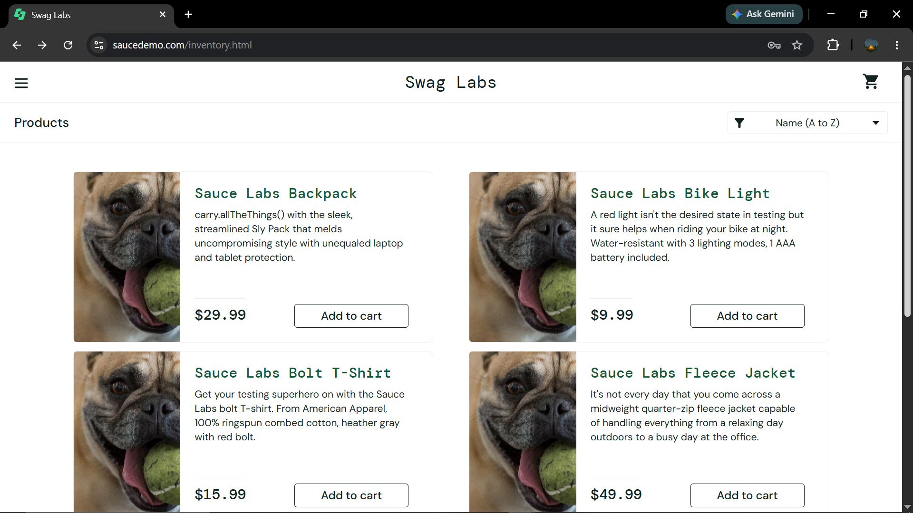
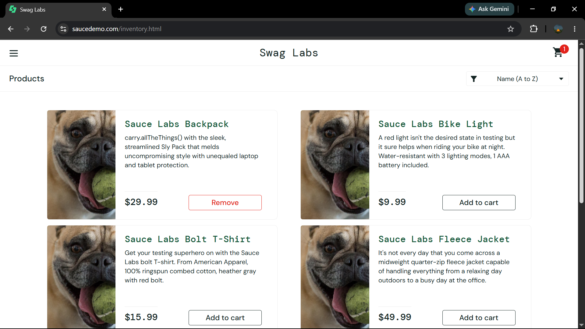

# Bug Report

## BUG-001 — Product Image Tidak Sesuai

| Field | Detail |
|---|---|
| Bug ID | BUG-001 |
| Test Case ID | TC-PROD-004 |
| Module | Product |
| Title | Gambar produk tidak sesuai dengan produk pada `problem_user` |
| Environment | Windows 10, Google Chrome 152 |
| Test Account | `problem_user` |
| Severity | Medium |
| Priority | Medium |
| Status | Open |

### Preconditions

1. Pengguna berada pada halaman login SauceDemo.
2. Akun `problem_user` tersedia.
3. Browser menggunakan Google Chrome 152.

### Test Data

```text
Username: problem_user
Password: secret_sauce
```

### Steps to Reproduce

1. Buka https://www.saucedemo.com/.
2. Login menggunakan akun `problem_user`.
3. Amati gambar produk pada halaman Products.

### Expected Result

Setiap produk menampilkan gambar yang sesuai dengan nama produknya.

### Actual Result

Semua produk menampilkan gambar yang sama (gambar anjing), sehingga gambar tidak sesuai dengan nama produk.

### Lampiran



---

## BUG-002 — Button Remove tidak dapat menghapus produk

| Field | Detail |
|---|---|
| Bug ID | BUG-002 |
| Test Case ID | TC-CART-003 |
| Module | Shopping Cart |
| Title | Button Remove tidak dapat menghapus produk pada `problem_user` |
| Environment | Windows 10, Google Chrome 152 |
| Test Account | `problem_user` |
| Severity | Major |
| Priority | High |
| Status | Open |

### Preconditions

1. Pengguna berada pada halaman login SauceDemo.
2. Akun `problem_user` tersedia.
3. Browser menggunakan Google Chrome 152.

### Test Data

```text
Username: problem_user
Password: secret_sauce
Product: Sauce Labs Backpack
Action: Add to cart → Remove
```

### Steps to Reproduce

1. Buka https://www.saucedemo.com/.
2. Login menggunakan akun `problem_user`.
3. Klik **Add to cart** pada produk Sauce Labs Backpack.
4. Klik **Remove** pada produk yang sama.
5. Amati ikon shopping cart.

### Expected Result

Produk dihapus dari shopping cart dan badge jumlah item hilang.

### Actual Result

Produk tidak terhapus. Tombol tetap menampilkan **Remove** dan badge shopping cart tetap `1`.

### Lampiran



---

# Bug Summary

| Bug ID | Module | Severity | Priority | Status |
|---|---|---|---|---|
| BUG-001 | Product | Medium | Medium | Open |
| BUG-002 | Shopping Cart | Medium | Medium | Open |

## Total Bug

- Total Bug: 2
- Open: 2
- Closed: 0
